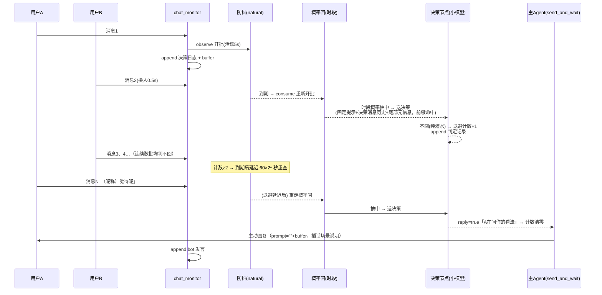

# 主动回复（AutoReply）

> 2026-10 设计，2026-10-26 实现落地（本文档与代码实现现状保持一致）。参考 MaiBot 触发调度
> （见 `cache/misc_not_plugin/MaiBot触发调度设计要点.md`）的防抖与时段思想，但不照搬其
> Planner（发消息即工具）架构——本项目在主 Agent **之前**加一个轻量 LLM 决策节点。

## 0. 净室声明与实现原则

- **净室开发（许可合规）**：MaiBot 采用 GPL-3.0，本项目为 MIT，许可不兼容。本设计借鉴其**思想**
  （防抖分档、概率闸、指数退避、append-only 上下文等），但所有代码独立实现：
  - 以本文档为唯一实现规范，不逐行翻译、不复制 MaiBot 源码（含常量、参数、注释）；
  - 防抖等待时长、退避公式系数等默认值自行标定，不要求与 MaiBot 取值一致；
  - 不引入 MaiBot 的代码、数据文件或其它衍生产物。
- **私聊不做主动回复**：主动回复仅面向群聊。私聊消息恒为 to_me，走被动通道，
  `chat_monitor` 的 `not_to_me` 规则天然将其排除在本流水线之外，无需额外配置。
- **随时提问**：改动中遇到任何本文档未定、存疑或与现状冲突的问题，先讨论后动手，不自行猜测拍板。

## 旧链路（已废除）

重构前的链路（`handler.py: handle_chat_monitor`）：

```
非@群消息 → add_message 进 buffer
          → buffer ≥ threshold 且 random() < probability
             → send_message_in_chunks(auto_reply=True)   # 触发那条消息当 prompt
```

问题：

1. **无防抖**：抽中即回，可能在别人话说到一半时插嘴；
2. **抽签纯随机不看内容**：「哈哈哈」与「bot 你觉得呢」同权重；
3. **无时段概念**：深夜与白天行为一致；
4. **模型不知道自己在主动插话**：触发消息被当成普通 prompt，回复姿态与被 @ 无异。

## 设计决策（已确认）

| 决策点 | 结论 |
|---|---|
| 抽签去留 | **彻底废除** threshold+probability 抽签，是否回复全由 LLM 决策 |
| 决策输出 | 二分类（回/不回）+ 一句理由（进日志，同时 append 进决策上下文） |
| 决策模型 | 独立小模型配置（`BaseAgentConfig`，留空回退主模型） |
| 决策上下文 | **原生 message 序列**（群消息=user / bot 回复=user 标注 / 判定=assistant），append-only，持久化 DB，为前缀缓存而设计 |
| 防抖参数 | 写死 natural 档，不暴露配置 |
| 时段规则 | 规则表 = 每时段一个**送审概率**（0~1，0 即免打扰），仅全局，不含 hint |
| 批次概率闸 | 防抖到期后按时段概率抽签，未抽中则批次跳过（消息留 buffer，重新开批） |
| 冷却/退避 | 连续 N 次决策不回 → MaiBot 式退避：到期延迟 base×2ⁿ 秒重查（上限 cap）；决策回即清零 |
| 文字提及 bot 名 | 不特殊处理，LLM 自己从消息里看出来 |
| 费用 | 决策调用与主动回复产出均不扣费（延续现状） |
| 决策记录 | 决策 messages 持久化 session store（全量+水位线，重启不 miss）；观测靠统计命令与结构化日志 |
| 适用范围 | **仅群聊**——私聊不做主动回复（to_me 被动通道天然覆盖，见 §0） |
| 许可合规 | 净室开发：MaiBot 为 GPL-3.0、本项目 MIT——思想可借鉴，实现独立编写，不复制其代码（见 §0） |
| 尾部元信息 | 只报「最近 K 条」数量与时间元信息，**不复制消息内容**（历史已含，避免重复固化） |
| 群黑名单 | 启用判定含群黑名单检查（`is_enabled`，延续旧 `should_auto_reply` 行为） |
| 主动执行前检查 | `send_auto_reply` 执行前 buffer 为空（被动轮已消费）则直接跳过，不凭空插话 |

## 总体架构

```
群消息（非 to_me）
  │
  ├─ add_message 进 buffer                    # 供主 Agent 消费
  ├─ append 进决策消息历史                     # ① 决策上下文，append-only，持久化 DB
  ├─ debouncer.observe(作者)                   # ② 消息防抖，写死 natural 档
  │
  └─ 防抖到期 ──────────────────────────────┐
                                            ▼
                              ③ 退避检查（连续不回计数 ≥ start？）
                                 └─ 退避中 → 延迟 min(base×2ⁿ, cap) 秒后重走 ③
                                            ▼
                              ④ 时段概率闸（仅全局规则表，未命中时段=1.0）
                                 ├─ 未抽中 → 批次跳过：消息留 buffer，防抖 consume 重新开批
                                 └─ 抽中 → ⑤
                                            ▼
                              ⑤ LLM 决策节点（独立小模型）
                                 输入 = 固定系统提示 + 决策消息历史 + 尾部元信息（message 序列）
                                 输出 = {reply: bool, reason: str}
                                 ├─ 不回 → 计数+1，append 判定记录，结束
                                 └─ 回 → 计数清零 → ⑥，append 判定记录与回复产出
                                            ▼
                              ⑥ 主动回复执行
                                 send_and_wait(prompt="", system_notification=插话场景说明)
                                 流式输出经 deliver.send_proactive 发回群

bot 发言（被动/主动）→ 以 user 消息 append 进决策历史
```

全部状态（防抖批次、退避计数、决策消息历史、进行中的决策任务）为 **session 级**，群与群互不影响。

## 1. 消息防抖（写死 natural 档）

`agent/debounce.py` 的 `MessageDebouncer`：纯内存状态机（不持久化、不用 asyncio 原语），
只负责批次划分与到期时刻计算，到期唤醒由调用方（`AutoReplyRuntime`）安排；
时间基准 `time.monotonic()`，参数写死不配置：

| 参数 | 值 | 常量 | 说明 |
|---|---|---|---|
| 安静开批 | 4.0s | `OPEN_QUIET_WAIT` | 新批次第一条，30s 内无消息 |
| 活跃开批 | 7.0s | `OPEN_ACTIVE_WAIT` | 新批次第一条，30s 内有过消息（消息可能还在路上） |
| 同人续发 | 10.0s | `SAME_AUTHOR_WAIT` | 批内后续消息，作者相同 |
| 换人续发 | 10.0s | `NEW_AUTHOR_WAIT` | 批内后续消息，作者不同 |
| 安静阈值 | 30s | `QUIET_GAP` | 判定「安静/活跃开批」的窗口 |
| 整批上限 | 20.0s | `BATCH_MAX_WAIT` | 以批次首条时刻钉制，防抖不能无限拖 |

接口：`observe(author)`（开批/推进到期）、`consume()`（收束批次，之后的消息开新批）、
`batch_size`、`deadline()`（当前批到期时刻，无批次为 None）。

到期时刻计算：新批按安静/活跃选开批等待；批内每条消息把到期重算为
`min(now + 续发等待, 首条时刻 + 整批上限)`——换人 0.5s 可使到期**提前**（多人对话节奏快），
但永不超过整批上限。

与 MaiBot 的差异（有意简化）：

- **不做裸图/纯表情特判**：本项目消息进 buffer 前已文本化（图片是占位/述图文字），「纯表情包」判定不可靠，收益低；
- **不做 @ 1 秒 urgent 通道**：to_me 消息走被动通道必回、不进入本流水线，无此需求；
- **到期批次不被新消息延长**：到期即触发决策任务；决策期间到达的消息留在 buffer、开新批防抖，
  若决策通过则随 `send_and_wait` 一并消费。

到期唤醒实现（`AutoReplyRuntime`）：每次 observe 后取消旧定时任务并重新安排
session 级 `asyncio.Task: sleep(deadline - now)` 到期触发；consume / 被动回复消费
buffer（`on_buffer_consumed`）时取消任务并重置批次。

## 2. 时段概率闸（仅全局）

防抖批次到期后，先按时段概率抽签决定**这批是否送决策节点**。时段表条目结构：

```python
class TimeWindow(AttrDocModel):
    start: time  # "HH:MM"
    end: time  # "HH:MM"，支持跨零点（23:00 → 07:00）
    weekdays_only: bool = False
    """仅工作日生效（周一至周五，剔除法定节假日）"""
    probability: float = 1.0
    """该时段每批送决策的概率；0 = 关闭主动回复，1 = 每批必送"""
```

匹配规则（`reply_gate.match_time_window`）：窗口命中判定为半开区间 `[start, end)`，
按北京时间；多个窗口命中时取**列表中最先声明**的（自上而下即优先级，简单可预期）；
都不命中时概率为 **1.0**（时段外每批必送）——若想全局限频，加一条全天窗口即可。

「不同时间段概率不同」的落地方式——概率作用于**送审闸门**而非回复本身：

- 深夜 `probability=0.0`：完全静默，最省（不调 LLM）；
- 傍晚 `probability=0.4`：每批 40% 机会送决策，送了仍由 LLM 结合内容判断；
- 白天默认 1.0：每批都问。

> 不做 hint 软倾向：时段只管送审频率，送审后的判断全凭日志内容，职责单一。

默认无时段表（`time_windows: []`，任何时段每批必送）；需要限频/免打扰时自行配置
（峰谷策略可直接抄进来表达）：

```yaml
time_windows:
  - {start: "00:00", end: "07:00", probability: 0.0}   # 深夜免打扰
  # 峰谷示例（billing 的工作高峰，weekdays_only 复用节假日判定）：
  # - {start: "09:00", end: "12:00", weekdays_only: true, probability: 0.5}
  # - {start: "14:00", end: "18:00", weekdays_only: true, probability: 0.5}
```

> 时间字段在 JSON Schema 中以 `HH:MM` pattern 描述（`WithJsonSchema` 覆盖），
> 不按 RFC3339 校验——`"07:00"` 这类写法不会在 yaml-language-server 里误报。

> billing 的峰谷（`is_peak_hours`）管**计费**，本表管**行为**，二者独立配置；
> `weekdays_only` 的非工作日判定由公共函数 `is_non_workday`（`utils/billing.py`）承担，
> `is_peak_hours` 的前置判定与其同源，避免两处逻辑漂移；调休上班的周六日仍视为非工作日
> （与峰谷计费语义一致）。

### 批次跳过的语义（未抽中时）

- 当前批次：**消息留在 buffer**（未来被动/主动回复时都会带给主 Agent），防抖 consume、重新开批；
- 决策消息历史照常 append（跳过只影响「是否送审」，不影响上下文累积）；
- 不计入退避计数（退避只统计「决策输出不回」，概率跳过根本没问 LLM）；
- 跳过后下一批的边界就是自然消息流——无需任何补偿逻辑。

## 3. 连续不回退避

MaiBot idle backoff 的变体，计数源是**决策节点的输出**：

- 决策输出「不回」→ 连续不回计数 +1；
- 决策输出「回」→ 计数清零（并执行主动回复）；
- 概率跳过的批次不计入（没问 LLM 就没有「不回」）。

计数 ≥ `backoff_start` 后，防抖到期**不立即走概率闸**，而是延迟
`min(backoff_base × 2^(count - start), backoff_cap)` 秒后重查（重新走 §2 概率闸）：

- 延迟期间新消息照常进 buffer / 日志 / 防抖（到期时间照常重算）；防抖再次到期时若重查任务
  已在挂起（`backoff_timer`），不重复安排；
- 延迟到点重查时对着**当前 buffer 全量**评估——若期间无新消息且概率未抽中，批次跳过、重新开批，
  不会对同一批无限重试；
- 默认参数：`start=2`、`base=60s`、`cap=1800s`（30 分钟封顶，默认值待实测调整）。

设计意图：连续被判「不回」说明群里没什么值得插话的，越久没事做就越少调决策 LLM（省钱）；
一旦回了（说明话题热起来了）立即满血。退避期间决策日志仍持续累积，重查时上下文不缺。

## 4. LLM 决策节点

决策节点位于 `agent/reply_gate.py`。

### 模型配置

`ReplyGateConfig(BaseAgentConfig)`：独立 model/provider/参数，`gate.model` 留空时
**整个回退主模型**（`effective_gate_config` 返回 `cfg.agent`，端点与参数一并继承）。
系统提示词可经 `gate.system_prompt_file` 指定（默认 `ReplyGate.md`，`gate_system_prompt()`
读入；文件缺失或为空时回退内置默认 `GATE_SYSTEM_PROMPT`）。决策调用不经过 crystal 计费。

决策 Agent 为进程级 lazy 单例（`get_gate_agent`）：系统提示在首次构建时读一次、进程内固定
（提示词须逐字节稳定以保前缀缓存命中，改文件需重启）+ `output_type=ReplyDecision`，
模型与 `ModelSettings` 按生效配置构建一次。决策模型的上下文窗口解析
（显式配置 > /models 元数据 > genai-prices）同样进程内固化一次（`gate_context_window`），
避免 registry/网络状态变化导致截断阈值漂移。

### 输入布局（原生 message 序列，为前缀缓存而设计）

决策请求不拼单条日志文本，保留**最原始的 message 结构**——每条群消息、每次判定、每条
bot 回复都是独立消息，append-only（提示中的 bot 名统一取 nonebot `nickname` 配置，
经 `{{ bot_name }}` 占位符或 `_bot_name()` 注入，不硬编码）：

```
system（默认见 config/chat/ReplyGate.md，可经 gate.system_prompt_file 指定；逐字节稳定）
  你是{{ bot_name }}的「插话决策器」：替她旁观群聊，判断此刻她是否应该主动开口。
  ……（详细版：记录格式说明 / 值得开口的情形 / 应该沉默的情形 / 元信息用法 /
  JSON 输出约定，判断标准贴合 bot 人设——如宵崎奏的「怕打扰别人，却也总想着
  能帮上谁的忙」「夜行性，深夜本身不是沉默的理由」「不救场、不追问」）

messages（append-only，前缀缓存主体，持久化 DB）
  user:      [10-26 14:02] 用户A(123)：……
  user:      [10-26 14:02] 用户B(456)：……
  assistant: {"reply": false, "reason": "纯表情灌水"}            ← 判定
  user:      [10-26 14:07] 用户C(789)：……
  assistant: {"reply": true, "reason": "C在问你的看法"}           ← 判定
  user:      [10-26 14:07] 昵称：觉得还行，主要是……             ← bot 实际回复
  …

本次决策轮（唯一变化部分；判定后固化进 messages）
  user: 待判定：最近 3 条消息（自上次判定以来的新增）。
        当前时间：10-26 12:00（周日）。
        昵称 上次发言距今：2分钟。
        上次主动回复距今：从未。
        连续沉默次数（近期决策均为不回）：2。
        请判断 昵称 此刻是否应该主动插话。
```

> 待判定的消息本体已在 messages 里，尾部元信息只报数量与时间，**不复制消息内容**（见决策表）。

角色与顺序约定（**assistant 角色专属决策器**，bot 的话以 user 角色标注，避免模型把回复误当自己的判定）：

| 消息 | 角色 | 来源 |
|---|---|---|
| 群消息 | user | `handle_chat_monitor`，一条消息一条 user（与 buffer 同格式 `[时间] 昵称(ID)：内容`） |
| 判定 | assistant | 以稳定 JSON 固化：`{"reply": ..., "reason": ...}`（`ensure_ascii=False`） |
| bot 发言 | user | 判定为「回」后，主动/被动回复产出以 `[时间] {昵称}：内容` 逐段追加 |

顺序即因果：群消息批 → 判定 →（若回）bot 回复 → 后续群消息……
「本批/历史」的区分就此消失——决策器看的是持续群聊流加自己的判定历史（能看到「我已连续潜水一阵」，与退避互为印证）。

pydantic-ai 实现：决策 Agent 每轮以 `message_history=决策消息历史` 运行，本轮 user 消息（尾部
元信息）与 assistant 判定在轮末固化进历史，天然 append-only。`SessionGateHistory.decide()`
返回 `GateOutcome(decision, usage)`；超时（`asyncio.wait_for`）或异常返回 None，由调用方
按「失败即放弃」处理。

### 持久化（session store 决策历史表）

决策消息历史持久化到 per-session SQLite（与主历史同库，`session_store.py` 新表），**重启不再 miss**：

```sql
CREATE TABLE gate_messages (
    id INTEGER PRIMARY KEY AUTOINCREMENT,
    kind TEXT NOT NULL DEFAULT 'msg',   -- 'msg' 普通行 | 'anchor' 摘要锚点行
    role TEXT NOT NULL,                 -- 'user' | 'assistant'
    content TEXT NOT NULL,
    created_at REAL NOT NULL
);
CREATE TABLE gate_state (key TEXT PRIMARY KEY, value TEXT NOT NULL);
```

- 全量 append 入库（`append_gate_messages`，返回新行 id）；截断不删行，只推进
  `gate_state` 中的**生效水位线** `watermark`（普通行起始行号）；
- 加载（`load_gate_history`）= `[最新一条 anchor 行] + [id ≥ watermark 的 msg 行]`；
  多次截断会产生多条锚点行，只有最新一条生效；
- `gate_state` 另存 `last_bot_at` / `last_proactive_at` 时间戳（元信息跨重启不丢）；
- 重启从水位线加载生效序列，请求前缀与关机前完全一致，前缀缓存跨重启命中；
- 水位线之前的全量行保留可回溯（何时判定过什么），不参与请求；会话 `reset`
  时随 `store.clear` 一并清空。

### 截断：截头 + 摘要锚点（复用主 Agent 压缩摘要档配置）

上限度量与截断参数直接复用 `cfg.compaction`，不新增配置：

| 项 | 取值 | 复用字段 |
|---|---|---|
| 触发上限 | 决策模型 context_window × 比例 | `summary_target_fraction`（None 回退 `trigger_fraction`=0.7） |
| 保留条数 | 截断后原样保留的最近消息条数 | `summary_keep_messages`（40） |
| 摘要模型 | 锚点摘要生成模型 | `summary_model`（None 继承决策模型） |
| 摘要模板 | 锚点摘要提示词（`{messages}` 占位） | `summary_prompt_file`（CompactionSummary.md） |

- 触发时机：每次决策发起前检查（`_maybe_truncate`，token 估算复用 compaction 的
  `estimate_request_tokens`），不设后台任务；
- 动作：保留最近 `summary_keep_messages` 条原始行，被截部分渲染为 `User:` / `Assistant:`
  行（对齐 CompactionSummary.md 的记录格式说明）填入摘要模板，由摘要模型压成**一条摘要
  锚点消息**（user 角色，固定前缀 `[以下是你之前旁观的群聊记录摘要…`，置于序列头部）；
- 新序列 = [摘要锚点] + [最近 N 条]，锚点行 append 入库（kind='anchor'）、水位线推进到
  保留部分首行，本次请求承受一次 miss；
- 摘要锚点跨重启生效（加载时最新锚点行置于最前）；生成失败（超时 120s / 空产出）则本次
  决策放弃，不留半截状态——摘要先生成、成功后才写库与替换内存；
- 生效行数 ≤ `summary_keep_messages` 时无可截内容，记 warning 照原样发起请求（罕见）；
- 摘要模板读取复用 compaction 的校验规则（含 `{messages}` 占位干跑校验），文件缺失或
  非法时回退内置简短模板。

### 前缀缓存命中条件

- 系统提示与 output schema（pydantic-ai `output_type=ReplyDecision`，`reply: bool` + `reason: str`）
  必须模板化固定，**不注入任何动态内容**（时间、计数只出现在本次决策轮的尾部 user 消息里）；
- messages append-only：条目一旦写入永不改写——跳过的批次、退避延迟期间的消息照常追加，
  下次请求的前缀与本次完全一致，命中到上一轮判定为止；
- 仅有的前缀失效点是**截断**（截头 + 重生成摘要锚点，一次 miss，之后重新命中）；
  重启不再是失效点（决策历史持久化 DB，见上节）；
- 命中与否取决于端点（DeepSeek/OpenAI 等自动前缀缓存），从决策 usage 的 `cache_read_tokens`
  观测：随结构化日志输出，并累计进 `决策统计` 命令（§6）。

### 运行语义

- **无锁**：决策只读日志快照，不占 `session.lock`；决策期间新消息照常进 buffer/日志；
- **到期即 consume**：防抖到期事件触发时即 consume 批次（重新开批），之后一切以 buffer/日志为准——
  退避延迟重查、概率跳过、决策中到达的新消息都属于下一批，无补偿逻辑；
- **防重入**：同一 session 同时最多一个决策任务（`gate_running` 标记）；运行中防抖再次
  到期则按正常流程走退避/概率闸，决策入口直接放弃本批；
- **失败即放弃**：超时（`gate_timeout`）/异常 → 本次不回（不计退避计数），日志 warning，不重试；
- **定时任务不静默**：防抖到期/退避重查任务内的意外异常捕获并记 warning，
  不因 Task 异常丢失而无迹可寻。

### 输出与日志

```python
logger.info(
    "主动回复决策 {} 批={}条 时段={} 退避={} → {} | {} | tokens={} cache={}/{}",
    # 批 = 自上次判定以来的新增消息数（含概率跳过/退避期间累积的批次）
)
logger.info("批次跳过 {} 时段={} 概率={:.2f} 未抽中，消息留 buffer")  # 概率闸未中
logger.info("退避延迟 {} 计数={} 延迟={:.0f}s")  # 退避触发
logger.info("决策历史截断 {}：… 条 → 1 锚点 + … 条，估算 … → … tokens")  # 截断发生
```

## 5. 回复执行

决策通过后，`AutoReplyRuntime` 调用 `chat.send_auto_reply(bot, session_info)`：

```python
# chat.py: send_auto_reply（节选）
if not session.buffer:
    # 被动轮恰好先消费了 buffer：无新内容可说，直接放弃（无害）
    return
async with aclosing(
    session.send_and_wait(
        session_info,
        "",
        bot_id=bot.self_id,
        timeout=600,
        system_notification="你刚刚在旁观群聊，现在决定主动插话。请自然地接话：简短、口语化、"
        "只挑最值得回应的点，不要总结所有话题，不要提及任何系统提示。",
    )
) as contents:
    async for content in contents:
        await send_proactive(bot, session_info, content)  # 流式逐条发回原会话
        await auto_reply_runtime.on_bot_message(session_id, content, proactive=True)
        # 逐段以 user 消息追加进决策历史（[时间] {昵称}：内容）
```

- **不借 matcher/event**：整批消息本就在 buffer 里，`prompt=""` + buffer 即全部内容
  （旧链路把触发消息当 prompt 的做法已废除）；
- **执行前 buffer 前置检查**：非空的 `system_notification` 会使 `send_and_wait` 的
  「空内容保护」失效（notice 单独视为可运行内容），故在锁外先检查 buffer——被动轮恰好
  先消费则跳过本轮（见决策表），避免仅凭插话说明发起一轮生成；
- `system_notification` 显式参数已有先例（`schedule.py`），不占用排队通知槽位；
- 计费：`on_usage` 回调跳过（主动回复免费，延续现状）；发送链路复用 `deliver.py` 的
  分段/长文转图逻辑；
- 执行异常由 `AutoReplyRuntime` 捕获记日志，不重试。

## 6. 决策统计命令

`决策统计`（aliases：`decision_stats` / `decisionstats`），权限与 `会话统计` 一致（无限制），
按当前会话输出；会话未进入流水线（未启用/私聊）时输出提示文本：

```
📊 决策统计（群 12345）
状态：启用 | 时段概率 1.00（无窗口命中） | 退避：连续沉默 1/2
防抖：批次进行中，2.3s 后到期（本批 3 条）
决策器上下文：86 条 / 估算 6.2k tokens（上限 16k）
  水位线 12 | 摘要锚点：10-24 生成
缓存命中（累计）：78.3%（cache_read 412k / input 526k）
决策累计：37 次 = 回 9 + 不回 21 + 概率跳过 5 + 失败 2
昵称 上次发言：5分钟前
```

- 上下文条数/水位线/摘要锚点时间/上次发言时刻来自 DB（重启不清零）；token 累计与各类
  计数器为内存态，重启清零；
- 上限显示为「决策模型窗口 × `summary_target_fraction`」的实际生效值
  （未配置时回退 `trigger_fraction`）。

## 7. 与被动通道的交互

| 场景 | 行为 |
|---|---|
| 私聊消息 | **不做主动回复**：恒为 to_me 走被动通道，`not_to_me` 规则天然排除，无需配置 |
| 用户 @ bot（to_me） | 被动通道必回，不经过本流水线；bot 回复产出 append 进决策日志 |
| 被动回复消费了 buffer | `send_and_wait` 清空 buffer 处回调 `on_buffer_consumed(session_id)`：取消挂起的防抖任务、重置批次（退避计数与决策日志保留） |
| 决策通过但用户恰好先 @ 了 | `send_and_wait` 排队等 `session.lock`，先到先得；若被动轮已消费 buffer，主动轮执行前的 buffer 检查不过 → `send_auto_reply` 直接返回（见 §5），无害 |
| 决策运行中 bot 被重启 | 决策消息历史从 DB 恢复，前缀缓存跨重启命中；防抖/退避/统计计数器为内存态，从零开始 |
| 会话重置（`重置会话`） | 决策历史表与元信息 kv（`gate_messages` / `gate_state`）随主历史 `store.clear` 一并清空 |

循环依赖注意：`auto_reply` 对 manager/chat 的引用一律函数内延迟导入，模块级依赖只含
debounce/reply_gate/config；`session.py` 经回调属性挂钩（`on_buffer_consumed`）解耦，
不反向依赖主动回复模块。

## 8. 配置结构

仅全局，`ScopedConfig.auto_reply`（旧 per-group `AutoReplyConfig(threshold, probability)` 已废除）：

```python
class ReplyGateConfig(BaseAgentConfig):
    """决策节点模型，model/provider 留空回退主模型"""

    system_prompt_file: str = "ReplyGate.md"  # 插话决策提示词文件，缺失回退内置默认


class AutoReplyConfig(AttrDocModel):
    """主动回复（仅全局配置）"""

    enabled: bool = False  # 总开关
    gate: ReplyGateConfig = ReplyGateConfig()
    time_windows: list[TimeWindow] = []  # 默认空：任何时段每批必送
    backoff_start: int = 2  # 连续决策不回 N 次后开始退避
    backoff_base: float = 60.0  # 退避基准秒：base × 2^(n-start)
    backoff_cap: float = 1800.0  # 退避上限秒
    gate_timeout: float = 30.0  # 决策调用超时（秒）
```

群的启用列表不在本配置，而是运行时配置 `ChatConfig.auto_reply_enabled_groups`
（`chat_configs.json`，与黑名单同源、按平台隔离），由 `/启用主动回复` `/禁用主动回复`
命令（SUPERUSER）维护：`set_group_enabled(group_id, platform, enabled)`（`auto_reply.py`）
改写列表并 `save_to_file()` 持久化，重启保留；`is_enabled` 每次现读，切换立即生效。

旧 per-group `AutoReplyConfig(threshold, probability)` 与
`ChatConfig.auto_reply_group_config: dict[str, AutoReplyConfig]` 字段均已移除，
console/onebot 平台结构保持 `get_by_platform` 不变。迁移：`chat_configs.json` 中的旧键
`auto_reply_group_config` 被忽略（存量均为空 dict），可择机清理。

截断上限与保留条数**复用 `cfg.compaction` 摘要档配置**（`summary_target_fraction` / `summary_keep_messages` /
`summary_model`），见 §4，不新增字段。

## 9. 代码结构

| 文件 | 职责 |
|---|---|
| `agent/debounce.py` | `MessageDebouncer`：纯内存防抖状态机（写死 natural 档，`monotonic` 时钟） |
| `agent/reply_gate.py` | `GATE_SYSTEM_PROMPT` / `ReplyDecision` / 时段窗口匹配 / 尾部元信息构建 / 决策 Agent（进程级 lazy 单例）/ `SessionGateHistory`（内存+DB 同步、决策调用、截断+摘要锚点） |
| `agent/auto_reply.py` | `AutoReplyRuntime`：per-session 状态（防抖定时、退避、防重入、计数器）、概率闸、决策编排、回复执行调度、`on_group_message` / `on_bot_message` / `on_buffer_consumed` 入口、统计输出；对 manager/chat 延迟导入 |
| `agent/session_store.py` | `gate_messages` / `gate_state` 表：全量 append、水位线、锚点行、kv 读写 |
| `agent/session.py` | `on_buffer_consumed` 回调属性：`send_and_wait` 轮末清 buffer 后触发（`reset` 丢弃不触发） |
| `chat.py` | `send_auto_reply`（流式主动发送 + 产出 append）；被动回复产出同样 append 进决策历史；旧 `should_auto_reply` 已删 |
| `handler.py` | `handle_chat_monitor`：消息进 buffer → 启用群进入主动回复流水线；`handle_decision_stats`；`/启用主动回复` `/禁用主动回复`（SUPERUSER，运行时切换） |
| `matcher.py` | `决策统计`、`启用主动回复`、`禁用主动回复` 命令注册 |
| `config.py` | `TimeWindow` / `ReplyGateConfig` / `AutoReplyConfig`（§8） |
| `utils/billing.py` | `is_non_workday`：非工作日公共判定（峰谷与 `weekdays_only` 同源） |
| `tests/nonebot/autoreply_smoke_test.py` | 冒烟：防抖断言、时段窗口、持久化往返、插件加载、编排端到端（mock 决策 LLM，含退避触发与统计输出） |

## 10. 时序示例



## 11. 明确不做的事

- 固定最小冷却间隔（两次主动回复间硬性间隔）——退避只由「连续决策不回」触发，语义不同；
- 文字提及 bot 名的特殊通道（LLM 自行识别）；
- 决策历史的 JSONL/外部导出——messages 已持久化 session store（全量+水位线），观测靠统计命令与结构化日志；
- 裸图/纯表情的防抖特判；
- per-group 时段/概率覆盖（仅全局）；
- MaiBot 式动态门控的窗口配额闭环与 8 特征概率回归——本项目用真 LLM 替代，时段概率闸是其极简版；
- 决策上下文与主 Agent 共享 message_history——两套独立序列（决策器含判定消息，主 Agent 不含），各自持久化。
