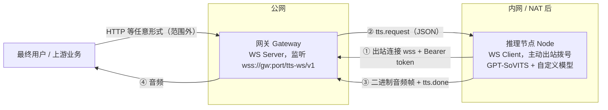
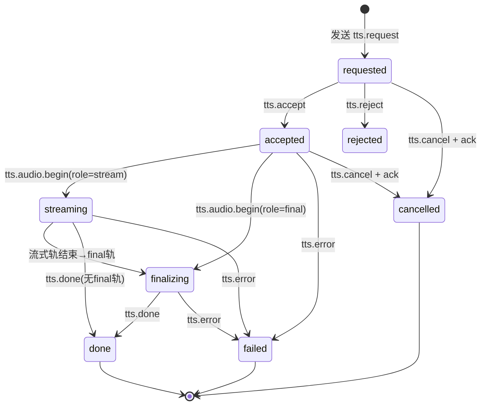
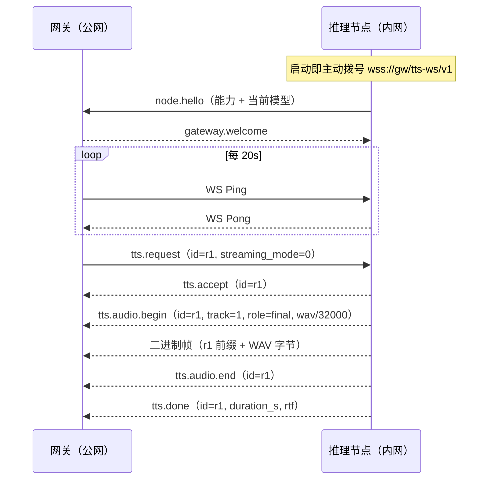
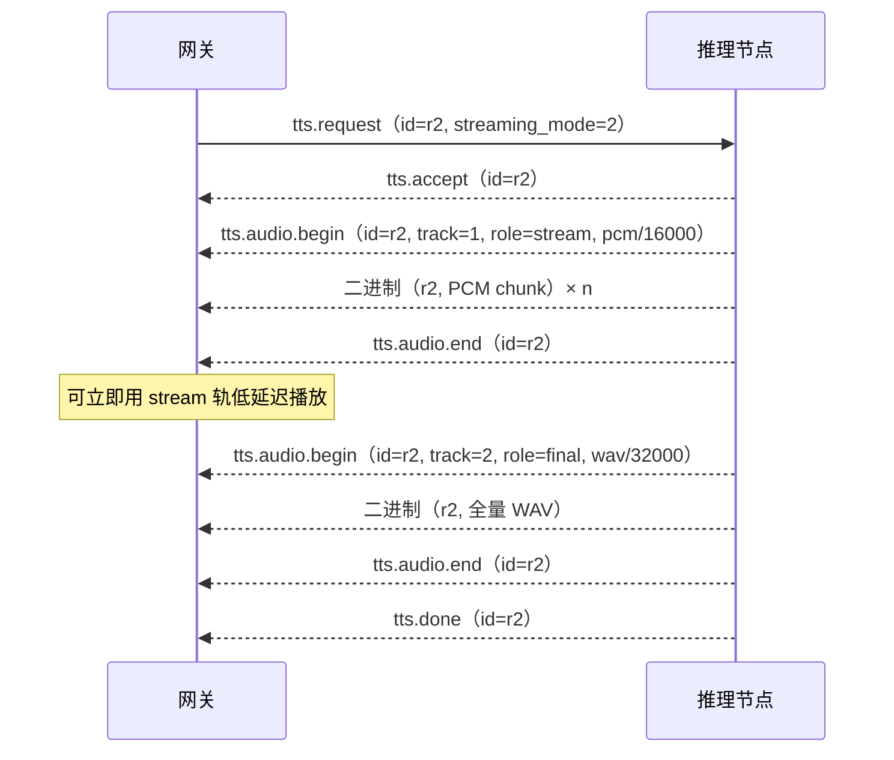
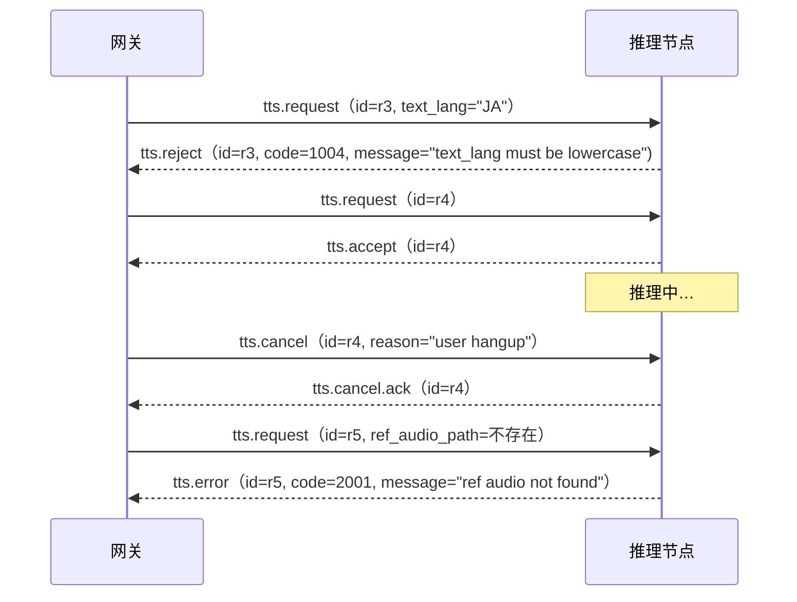

# Kanade TTS 反向 WebSocket 协议（tts-ws/1.0）

- 版本：`tts-ws/1.0`（2026-11-14 设计稿）
- 参数集对齐：`GPT-SoVITS-main/api_v2.py` 的 `TTS_Request`（全量透传）
- 范围：本文档只定义 **网关 ↔ 推理节点** 这一跳的协议；网关对最终用户暴露什么接口（HTTP/WS/REST）不在范围内

---

## 1. 拓扑与术语

需求：TTS 推理机在 NAT/内网，无公网入口；公网机器做中转。**连接方向与逻辑角色相反**——推理机是"服务提供方"，但由它主动出站拨号。

| 本文档术语 | 需求中的叫法 | WebSocket 角色 | 位置 | 职责 |
|---|---|---|---|---|
| **推理节点 Node** | TTS server | WS **Client**（主动拨号） | 内网 | 持有 GPT-SoVITS 模型，执行推理，回传音频 |
| **网关 Gateway** | 公网 client | WS **Server**（监听） | 公网 | 接受反向连接，向节点下发请求，把音频转交最终用户 |
| 最终用户 Caller | — | — | 任意 | 向网关发起 TTS 请求（协议范围外） |



设计原则：

1. **单条反向长连接复用所有请求**，用 `request_id`（`id` 字段）关联请求与响应，支持并发/交错
2. **控制面走文本帧（JSON），音频面走二进制帧**——流式低开销，无需 base64（省 33% 带宽）
3. 请求参数**与 `api_v2.py` 字段一一对应**（snake_case 原样），减少心智负担
4. `*_path` 类参数传递**推理节点本地路径**（当前部署假设两台进程同机/共享文件系统；见 §10 安全建议）
5. **运行哪个模型由节点配置决定**（`tts_infer.yaml`），请求不指定模型，节点在注册时上报当前模型
6. 心跳保活 + 指数退避重连；在途请求断线即作废，可由网关重派（固定 seed 可复现）

---

## 2. 连接层

### 2.1 建立

- URL：`wss://<gateway-host>:<port>/tts-ws/v1`（公网必须 `wss`；纯内网可用 `ws`）
- 鉴权：HTTP 头 `Authorization: Bearer <token>`（或退化用 `?token=` 查询参数）。鉴权失败：网关拒绝握手（401），节点退避重试
- 可选声明子协议：`Sec-WebSocket-Protocol: tts-ws.v1`
- 帧限制：文本帧 ≤ 1 MiB；二进制帧建议 16–64 KiB（见 §6）
- `permessage-deflate`：允许开启；PCM 压缩率低，音频收益有限，可协商关闭

### 2.2 应用层注册握手

连接成功后 **5 秒内** 节点必须发 `node.hello`，网关回 `gateway.welcome`；任一方超时即断开。

`node.hello`（N→G）——能力与当前模型上报：

```json
{
  "type": "node.hello",
  "ts": 1763120000000,
  "payload": {
    "node_id": "kanade-tts-01",
    "protocol": "tts-ws/1.0",
    "capabilities": {
      "version": "v2",
      "languages": ["zh", "ja", "en", "ko", "yue", "auto", "auto_yue"],
      "cut_methods": ["cut0", "cut1", "cut2", "cut3", "cut4", "cut5"],
      "media_types": ["wav", "raw", "ogg", "aac"],
      "streaming_modes": [0, 1, 2, 3],
      "gpt_streaming": false,
      "max_concurrency": 1,
      "max_text_chars": 1000,
      "native_sample_rate": 32000
    },
    "models": {
      "gpt": "GPT_weights_v2/kanade_v2-e4.ckpt",
      "sovits": "SoVITS_weights_v2/kanade_v2_e4_s648.pth",
      "device": "cpu",
      "is_half": false
    }
  }
}
```

`gateway.welcome`（G→N）：

```json
{
  "type": "gateway.welcome",
  "ts": 1763120000050,
  "payload": {
    "session_id": "s-7c1e…",
    "heartbeat_interval_s": 20,
    "heartbeat_timeout_s": 60,
    "server_time": 1763120000050
  }
}
```

> `max_concurrency`：本机 CPU 推理实测 RTF≈1.4–1.75、串行锁（`api_v2` 内部即全局锁），默认 `1`。网关据此决定下发节奏；超发的请求节点可回 `tts.reject(2006)`。

### 2.3 心跳

- 网关每 `heartbeat_interval_s`（默认 20s）发 WS **Ping** 帧（opcode 0x9），节点必须回 **Pong**（0xA）
- 连续 `heartbeat_timeout_s`（默认 60s）无 Pong → 判死，双方关闭连接；节点立即进入重连流程
- 节点也可主动 Ping 探活；应用层 `ping` 消息类型保留（当前不用）

### 2.4 重连

- 节点侧重连退避：1s → 2s → 4s → … → 上限 30s，附加 ±20% 抖动
- 重连成功后重新走 `node.hello` 注册（新 `session_id`）
- **断线语义**：旧连接上所有在途请求立即失败——节点侧作废未完成的推理，网关侧对上游报 `3001/3002`，或在新连接上用相同参数（含固定 seed）重派

---

## 3. 消息封套

### 3.1 文本帧（JSON，UTF-8）

```json
{
  "type": "tts.request",
  "id": "r-8f14e45f-ea0b-4c2a-9d3f-1e2b3c4d5e6f",
  "ts": 1763120001000,
  "payload": {}
}
```

| 字段 | 必填 | 说明 |
|---|---|---|
| `type` | ✅ | 消息类型，见 §4 |
| `id` | 条件 | 请求关联 ID（UUIDv4 或雪花 ID）。凡属于某次 TTS 请求的消息**必填**且全程不变 |
| `ts` | ✅ | 发送方 Unix 毫秒时间戳 |
| `payload` | 条件 | 各类型自定义负载 |
| `payload.code` / `payload.message` | 错误消息 | 错误码（§8）与人读信息 |

### 3.2 二进制帧（仅音频，方向固定 N→G）

```
字节布局（小端无关，纯前缀拼接）：
+-----------+----------------------+---------------------------+
| 1 字节     | id_len 字节 (UTF-8)   | 其余全部字节               |
| id_len    | request_id           | 音频载荷（PCM/WAV/…）      |
+-----------+----------------------+---------------------------+
约束：0 < id_len ≤ 64
```

- 二进制帧属于**该 `request_id` 当前打开的音轨**（音轨概念见 §6）
- 二进制帧只用于音频数据；任何控制/错误信息一律走文本帧
- 推荐单帧 16–64 KiB；收满 `tts.audio.end.payload.expected_bytes`（如声明）可校验完整性

---

## 4. 消息类型总表

| type | 方向 | 关联核心 payload | 说明 |
|---|---|---|---|
| `node.hello` | N→G | capabilities / models | 注册 + 能力上报（§2.2） |
| `gateway.welcome` | G→N | heartbeat 参数 | 注册确认 |
| `tts.request` | G→N | 推理参数（§5） | 发起一次推理 |
| `tts.accept` | N→G | `queue_position`? | 节点已受理（排队或开始） |
| `tts.reject` | N→G | `code`, `message` | 受理前拒绝（参数非法/忙/超发） |
| `tts.progress` | N→G | `stage`, `percent` | 可选进度（gpt / vits / 切分段数） |
| `tts.audio.begin` | N→G | 音轨元数据 | 开启一条音轨（§6） |
| （二进制帧） | N→G | 音频字节 | 音轨数据 |
| `tts.audio.end` | N→G | `bytes`, `duration_s` | 关闭当前音轨 |
| `tts.done` | N→G | 汇总统计 | **成功终态** |
| `tts.error` | N→G | `code`, `message` | **失败终态** |
| `tts.cancel` | G→N | `reason`? | 取消在途请求 |
| `tts.cancel.ack` | N→G | — | 取消确认（5s 内未回，网关可断线兜底） |
| `node.status` | N→G | `state`, `queue_len` | 可选：空闲/忙推送，帮助网关排水队列 |
| `node.bye` | N→G | `reason` | 节点优雅下线预告 |

未知 `type`：回一条应用层错误（`code=1003`，带原 `type`），**不**断开连接（向前兼容）。

### 4.1 请求状态机（网关视角）



任一请求收到终态（`tts.done` / `tts.error` / `tts.cancel.ack`）后，双方释放该 `id` 的上下文；此后再收到该 `id` 的消息一律忽略。

---

## 5. `tts.request` 参数

### 5.1 约定

- **必填**：`text`、`text_lang`、`ref_audio_path`、`prompt_lang`
- 语言代码**一律小写**（`"ja"` 而非 `"JA"`，`"zh"` 而非 `"ZH"`）——与 `api_v2.check_params` 一致，大写会被节点以 `1004` 拒绝
- 所有 `*_path` 为**推理节点本地路径**（绝对或相对节点工作目录）
- 未列出的字段一律用节点默认值；字段与 `api_v2.py` `TTS_Request` 一一对应

### 5.2 基础合成参数

| 参数 | 类型 | 必填 | 默认 | 说明 |
|---|---|---|---|---|
| `text` | string | ✅ | — | 待合成文本，长度 ≤ `hello.max_text_chars` |
| `text_lang` | string | ✅ | — | 文本语言（小写），∈ `hello.languages` |
| `ref_audio_path` | string | ✅ | — | 参考音频（音色/情感来源），节点本地路径 |
| `aux_ref_audio_paths` | string[] | ❌ | `[]` | 多参考音色融合辅助音频，同样为节点本地路径 |
| `prompt_text` | string | ❌ | `""` | 参考音频的文字转写（强烈建议提供，否则质量下降） |
| `prompt_lang` | string | ✅ | — | 参考音频语言（小写） |

### 5.3 采样与生成控制

| 参数 | 类型 | 默认 | 说明 |
|---|---|---|---|
| `top_k` | int | 15 | T2S（GPT 侧）top-k 采样 |
| `top_p` | float | 1.0 | top-p 采样 |
| `temperature` | float | 1.0 | 采样温度 |
| `repetition_penalty` | float | 1.35 | T2S 重复惩罚 |
| `seed` | int | -1 | 随机种子；`-1` 随机；固定值可复现（本项目对照实验固定 42） |

### 5.4 切分与批处理

| 参数 | 类型 | 默认 | 说明 |
|---|---|---|---|
| `text_split_method` | string | `"cut5"` | 文本切分：`cut0` 不切 / `cut1` 凑四句一切 / `cut2` 凑约 50 字一切 / `cut3` 按中文句号 / `cut4` 按英文句号 / `cut5` 按标点。短句对照实验用 `cut0` |
| `batch_size` | int | 1 | SoVITS 段级批大小（CPU 建议 1） |
| `batch_threshold` | float | 0.75 | 长句批切分阈值 |
| `split_bucket` | bool | true | 是否按桶分组并行 |
| `parallel_infer` | bool | true | CPU 节点建议 `false` |
| `fragment_interval` | float | 0.3 | 多段合成时段间静音（秒） |

### 5.5 语速与输出

| 参数 | 类型 | 默认 | 说明 |
|---|---|---|---|
| `speed_factor` | float | 1.0 | 语速（建议 0.5–2.0） |
| `media_type` | string | `"wav"` | `wav` / `raw`(=headerless PCM) / `ogg` / `aac` |
| `streaming_mode` | bool\|int | `false` | `0/false` 整段一次返回；`1/true` 分段返回（质量优先，首包慢）；`2` 流式（中质量）；`3` 低延迟流式（定长块） |

### 5.6 流式细调

| 参数 | 类型 | 默认 | 说明 |
|---|---|---|---|
| `overlap_length` | int | 2 | 流式语义 token 重叠长度 |
| `min_chunk_length` | int | 16 | 流式最小语义块长（影响首包大小/粒度） |
| `gpt_streaming` | bool | false | 语义 token 级流式。**组合限制**：需模型支持（`hello.capabilities.gpt_streaming`），且 `streaming_mode ∈ {2,3}`、`batch_size = 1`、`media_type ∈ {raw, wav}`；非法组合 → `tts.reject(2005)` |
| `streaming_chunk_seconds` | float | 2.0 | 固定窗口时长（秒） |
| `streaming_window_mode` | string | `"fixed"` | `fixed` / `hybrid`（取决于模型支持） |
| `streaming_lookahead_seconds` | float | 0.12 | 音频流前瞻 |
| `streaming_overlap_seconds` | float | 0.04 | 音频流重叠 |
| `gpt_streaming_lookahead_seconds` | float | 0.5 | 语义流前瞻 |

### 5.7 v3 / v4 / v5 专属（当前 v2 节点接收但**惰性忽略**）

| 参数 | 类型 | 默认 | 说明 |
|---|---|---|---|
| `sample_steps` | int? | null | DiT 采样步数 |
| `cfg_rate` | float? | null | CFG 强度 |
| `super_sampling` | bool | false | v3 超采样 |
| `cache_dit` | string | `"off"` | `off` / `auto` / `f4` / `f8` / `f16`；4 步运行会被拒绝 |
| `dbcache_fn` | int? | null | 前置缓存块数 |
| `dbcache_threshold` | float? | null | 残差差相对阈值 |
| `dbcache_warmup` | int? | null | 开头强制全算步数 |
| `dbcache_downsample` | int? | null | 时间下采样倍率 |

### 5.8 性能开关（节点可按自身硬件覆盖）

| 参数 | 类型 | 默认 | 说明 |
|---|---|---|---|
| `use_cuda_graph` | bool | true | CUDA Graph；CPU 节点自动忽略 |
| `use_flash_attention` | bool | true | FlashAttention；节点可强制覆盖 |

### 5.9 节点侧校验规则（违反 → `tts.reject`，不进入推理）

1. `text` 非空且 ≤ `max_text_chars`（否则 `2003/2008`）
2. `text_lang` / `prompt_lang` 必须本身为小写：含大写字母 → `1004`（不静默规范化，尽早暴露调用方错误）；合法小写但不在 `hello.languages` → `2002`
3. `ref_audio_path` 非空、存在且可读、位于白名单根目录内（否则 `2001`）
4. `media_type` ∈ `{wav, raw, ogg, aac}`；`text_split_method` ∈ `cut_methods`；`streaming_mode` ∈ `{0,1,2,3,true,false}`（否则 `1004`）
5. `gpt_streaming` 组合限制（否则 `2005`）
6. `id` 去重：与最近完成的请求重复 → `1005`

---

## 6. 音轨（Track）与音频传输

一次请求的音频 = **1..N 条音轨**，每条音轨：`tts.audio.begin` → 0..M 个二进制帧 → `tts.audio.end`。同一请求内音轨按 `track` 序号递增；二进制帧归属"该 `id` 当前打开的音轨"（连接内帧有序，天然无歧义）。

`tts.audio.begin` payload：

| 字段 | 说明 |
|---|---|
| `track` | 音轨序号，从 1 起 |
| `role` | `stream`（低延迟预览）/ `fragment`（分段结果）/ `final`（最终全量结果） |
| `format` | `pcm` / `wav` / `ogg` / `aac`（对齐 `media_type`；`raw` 统一表示为 `pcm`） |
| `sample_rate` | 如流式 16000，v2 最终 32000 |
| `channels` | 恒为 1 |
| `bits` | 恒为 16（s16le） |
| `expected_bytes` | 可选，总字节数（整轨已知时） |

各模式映射（对齐 `api_v2` 行为）：

| streaming_mode | 音轨序列 |
|---|---|
| 0（非流式） | 1 条 `final` 轨（默认 32 kHz WAV；`media_type` 决定容器） |
| 1（分段） | 每段一条 `fragment` 轨 |
| 2 / 3（流式） | 先 1 条 `stream` 轨（headerless PCM s16le，**采样率以 begin 元数据为准**：本 fork v2 实现为 32 kHz，上游部分版本为 16 kHz）→ 后 1 条 `final` 轨（全量 WAV）。网关要即时播放 `stream` 轨时，用 `begin` 元数据自行封装 WAV 头（等价 `api_v2` 的 `wave_header_chunk` 技巧），`final` 轨用于落盘/转发。注：本 fork 流式生成器不追加全量音频，`final` 轨由**节点拼接 stream chunk** 后打包得出 |

背压：WebSocket/TCP 自带流控；网关必须及时消费二进制帧，否则会反压节点推理发送线程。

`tts.done` payload（成功终态，汇总）：

```json
{
  "type": "tts.done",
  "id": "r-8f14…",
  "payload": {
    "duration_s": 3.42,
    "audio_bytes": 330240,
    "sample_rate": 32000,
    "tracks": 1,
    "segments": 1,
    "rtf": 1.58,
    "seed_used": 42
  }
}
```

---

## 7. 时序图

### 7.1 注册 + 非流式合成



### 7.2 流式合成（streaming_mode=2）



### 7.3 拒绝 / 取消 / 错误



---

## 8. 错误码

| code | 名称 | 触发方 | 说明 |
|---|---|---|---|
| 1001 | unauthorized | 网关 | token 缺失/错误（通常直接握手失败） |
| 1002 | bad_frame | 双方 | 帧格式非法（JSON 解析失败、二进制前缀越界等） |
| 1003 | unknown_type | 双方 | 未知消息类型（连接保持） |
| 1004 | invalid_params | 节点 | 参数校验失败（语言大写、非法枚举值…），**拒绝于 accept 之前** |
| 1005 | duplicate_id | 节点 | `request_id` 与最近完成请求重复 |
| 2001 | ref_audio_error | 节点 | 参考音频不存在/不可读/超界（时长、格式）/不在白名单 |
| 2002 | lang_unsupported | 节点 | 语言不在节点支持列表 |
| 2003 | text_too_long | 节点 | 超过 `max_text_chars` |
| 2004 | inference_failed | 节点 | 推理内部异常（`detail` 可带 traceback 摘要） |
| 2005 | streaming_combo_invalid | 节点 | `gpt_streaming` 组合限制不满足 |
| 2006 | node_busy | 节点 | 超过 `max_concurrency` 的超发请求 |
| 2007 | resource_exhausted | 节点 | 内存/显存不足 |
| 2008 | empty_text | 节点 | `text` 为空 |
| 3001 | node_offline | 网关 | 节点断线，在途请求作废 |
| 3002 | timeout | 网关 | 任一阶段超时（§9） |
| 3009 | cancelled | 双方 | 已取消 |

---

## 9. 超时、幂等与可靠性

| 阶段 | 建议超时 | 说明 |
|---|---|---|
| TCP+TLS+WS 握手 | 10s | 失败进入退避重连 |
| `hello` ↔ `welcome` | 5s | 超时断开重连 |
| `tts.request` → `tts.accept`/`reject` | 10s | |
| `accept` → 首个二进制帧 | 120s | CPU 长文本首包慢，放宽 |
| 整请求 → `tts.done`/`error` | `max(180s, 3×预估音频秒数)` | 本机 CPU 实测 RTF≈1.4–1.75，按 `text 长度 ÷ 语速` 估音频秒数 |
| `tts.cancel` → `cancel.ack` | 5s | 未回则网关可断开连接兜底 |

- **幂等**：`request_id` 全局唯一；节点缓存最近 N 个（如 256 个）终态 `id`，重复请求回 `1005`（防网关重派风暴）。固定 `seed` 下同参数重放结果可复现，网关可安全地在重连后重派
- **顺序**：单连接内 WS 帧有序；节点按 `accept` 顺序串行推理（`max_concurrency=1`），响应天然不交错错乱

---

## 10. 安全建议

1. 公网必须 `wss` + Bearer token；token 与节点一一对应，可单独吊销
2. 节点对 `ref_audio_path` / `aux_ref_audio_paths` 做**根目录白名单**校验（如只允许 `dataset/` 与配置目录），防止借 path 参数探测/读取任意文件（即便假设同机，也防下游业务误用）
3. `text` 长度上限（默认 1000 字符）+ 网关侧限流，防止长文本把 CPU 节点拖死
4. 节点**只出站、不监听**，公网零暴露面
5. `tts.error.detail` 中的 traceback 仅在受信网络回传，公网网关应剥离后再透出给最终用户

---

## 11. 完整示例会话

```jsonc
// ── N→G：注册 ──
{"type":"node.hello","ts":1763120000000,"payload":{"node_id":"kanade-tts-01","protocol":"tts-ws/1.0",
 "capabilities":{"version":"v2","languages":["zh","ja","en"],"cut_methods":["cut0","cut1","cut2","cut3","cut4","cut5"],
 "media_types":["wav","raw","ogg","aac"],"streaming_modes":[0,1,2,3],"gpt_streaming":false,
 "max_concurrency":1,"max_text_chars":1000,"native_sample_rate":32000},
 "models":{"gpt":"GPT_weights_v2/kanade_v2-e4.ckpt","sovits":"SoVITS_weights_v2/kanade_v2_e4_s648.pth","device":"cpu","is_half":false}}}

// ── G→N：注册确认 ──
{"type":"gateway.welcome","ts":1763120000050,"payload":{"session_id":"s-7c1e","heartbeat_interval_s":20,"heartbeat_timeout_s":60}}

// ── G→N：发起合成（本项目对照实验典型参数） ──
{"type":"tts.request","id":"r-8f14e45f","ts":1763120001000,"payload":{
 "text":"これで……ちゃんとできてるかな……",
 "text_lang":"ja",
 "ref_audio_path":"/home/cola/Projects/GitHub/Kanade-GPT-SoVITS/dataset/kanade_val/audio/event_145_05_voice_ev_night_18_05_06_17.wav",
 "prompt_text":"なんだか、タイトルからそれらしくていいね",
 "prompt_lang":"ja",
 "text_split_method":"cut0",
 "media_type":"wav",
 "streaming_mode":0,
 "top_k":15,"top_p":1.0,"temperature":1.0,"repetition_penalty":1.35,
 "speed_factor":1.0,"seed":42,"batch_size":1,"parallel_infer":false}}

// ── N→G：受理 ──
{"type":"tts.accept","id":"r-8f14e45f","ts":1763120001010,"payload":{}}

// ── N→G：音轨开启 ──
{"type":"tts.audio.begin","id":"r-8f14e45f","ts":1763120001080,
 "payload":{"track":1,"role":"final","format":"wav","sample_rate":32000,"channels":1,"bits":16}}

// ── N→G：二进制帧（前缀 0x0A + "r-8f14e45f" + WAV 字节）× n ──

// ── N→G：音轨结束 ──
{"type":"tts.audio.end","id":"r-8f14e45f","ts":1763120006900,"payload":{"track":1,"bytes":219524,"duration_s":3.42}}

// ── N→G：成功终态 ──
{"type":"tts.done","id":"r-8f14e45f","ts":1763120006905,
 "payload":{"duration_s":3.42,"audio_bytes":219524,"sample_rate":32000,"tracks":1,"segments":1,"rtf":1.62,"seed_used":42}}
```

---

## 附录 A：与 `api_v2.py` 的差异说明

| 事项 | `api_v2.py`（HTTP） | 本协议（WS） |
|---|---|---|
| 携带 `return_fragment` | 内部由 `streaming_mode` 派生 | 不暴露，同样由 `streaming_mode` 派生 |
| `media_type=raw` | 裸 PCM 字节流 | 音轨 `format:"pcm"` + 元数据（采样率等在 `begin` 里，不再隐含） |
| 流式 WAV | HTTP 首块塞 WAV 头 + 后续 raw | `stream` 轨元数据自带参数，网关自行封头；`final` 轨为完整 WAV |
| 模型切换 | `/set_gpt_weights`、`/set_sovits_weights` 端点 | **不提供**（模型由节点配置决定）；如需运维切换，预留扩展 `node.set_weights`，默认关闭 |
| `/control` restart/exit | 端点 | 不提供；`node.bye` 仅作优雅下线预告 |

## 附录 B：当前部署（v2 / CPU）备注

- 节点 `version=v2`：`sample_steps` / `cfg_rate` / `super_sampling` / `cache_dit` / `dbcache_*` / `gpt_streaming` 全部惰性或不可用，节点照单全收但不生效（为升 v3/v4 预留）
- CPU（12 核）实测：非流式 RTF≈1.4–1.75、峰值内存约 4.8 GB → `max_concurrency=1`、`parallel_infer=false`、`batch_size=1` 是节点默认；网关排队的体验优于节点内部并发
- `streaming_mode 2/3`：流式 chunk 采样率 = `output_sr`（v2=32000，非上游部分版本的 16 kHz），错误哨兵为 16000 静音（节点用采样率一致性过滤丢弃）；生成器不追加全量音频 → 节点拼接 chunk 生成 `final` 轨；CPU 首包收益显著，网关对外承诺延迟以 `stream` 轨首包为准
